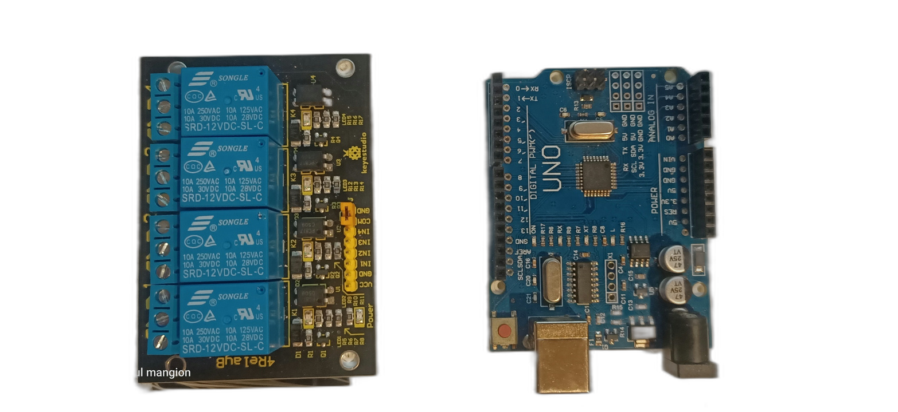
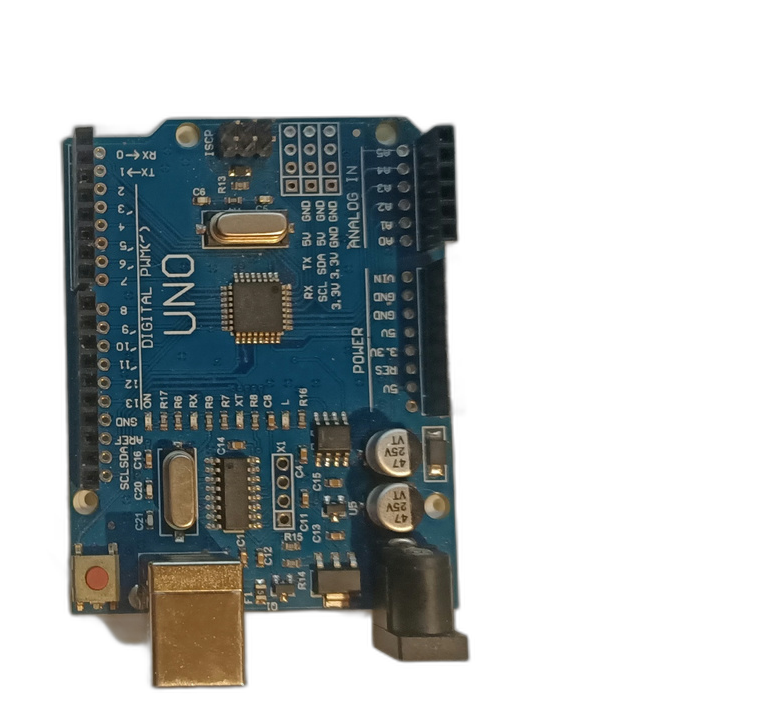
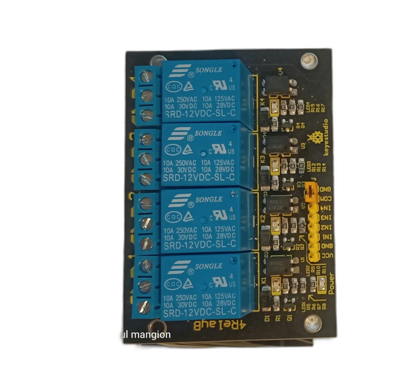
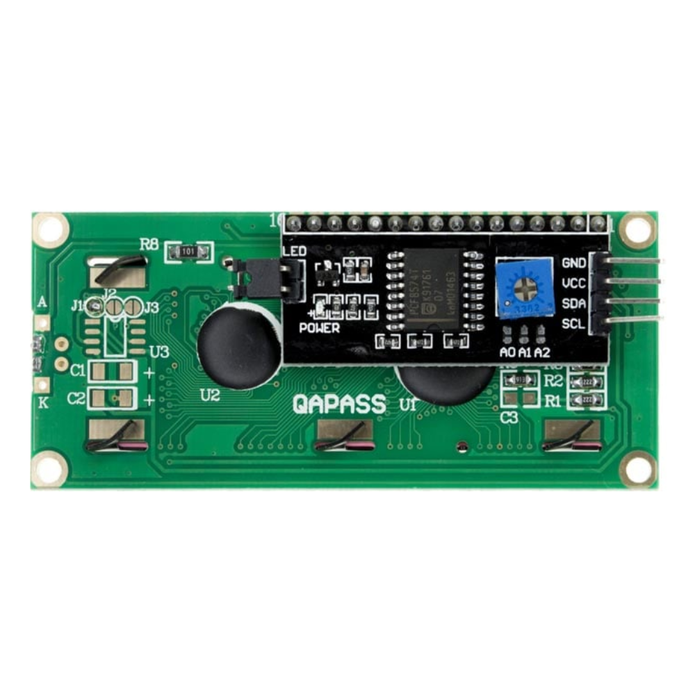
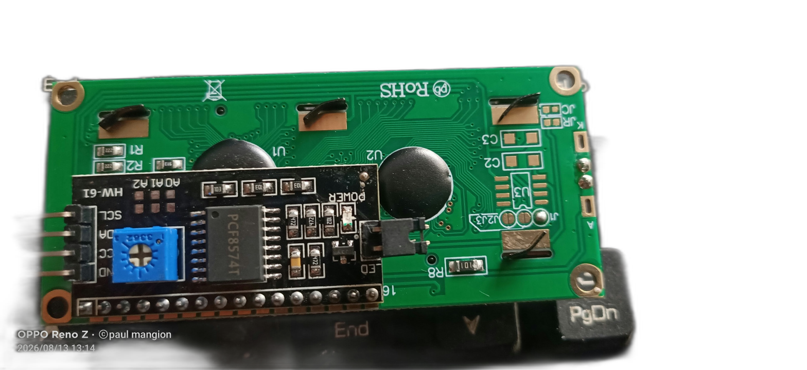
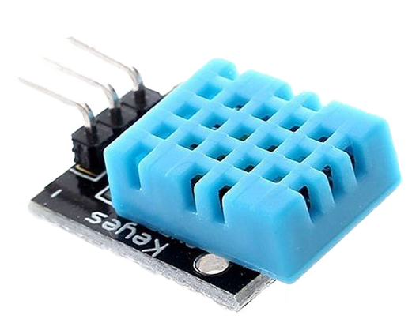
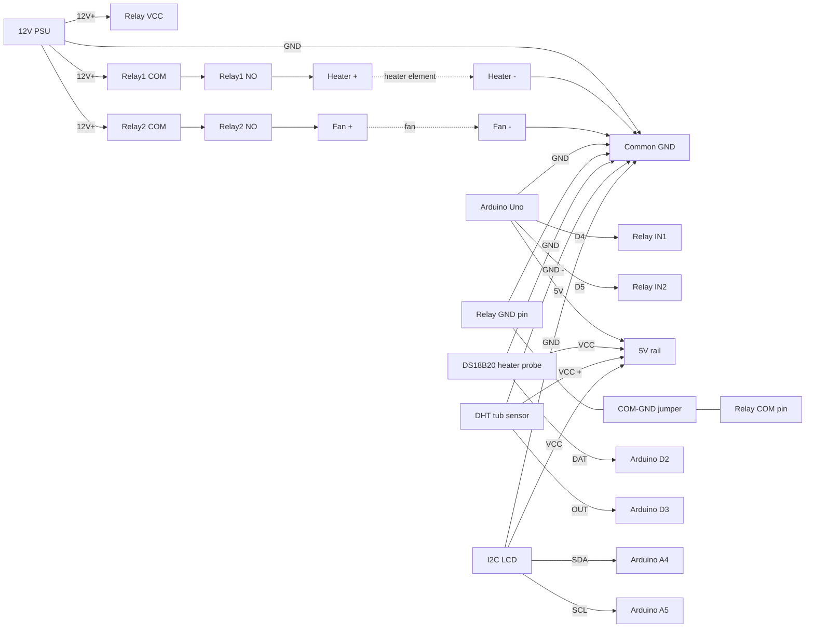

# Filament Dryer Box

An Arduino-controlled 3-tier filament drying box. Heats a tub to a target
temperature range with a relay-switched 12V cartridge heater, cools the
heatsink with a 12V fan, and displays live status on an I2C LCD.

[](https://ko-fi.com/plmangion)



## Tiers

- **Tier 1** — Arduino Uno + wiring
- **Tier 2** — 4-channel relay board
- **Tier 3 (top)** — I2C LCD display (temps, humidity, heater/fan icons)

## Parts

| Part | Notes |
|---|---|
| Arduino Uno | main controller |
| Keyestudio 4-channel relay module (SRD-12VDC-SL-C) | switches heater + fan |
| DS18B20 waterproof temp probe ("heater" sensor) | mounted on the heatsink |
| DHT11/DHT22 temp+humidity sensor ("tub" sensor) | mounted inside the drying tub |
| 16x2 LCD with I2C backpack (PCF8574T) | status display |
| 12V 70W cartridge heater (6x20mm) | heats the heatsink |
| 12V fan (Cooler Master 12025) | cools the heatsink |
| External 12V power supply | powers heater, fan, and relay coils |

### Component photos

| Arduino Uno | Keyestudio 4-ch Relay (SRD-12VDC-SL-C) |
|---|---|
|  |  |

| 16x2 LCD + PCF8574T I2C backpack (front) | I2C backpack (back) |
|---|---|
|  |  |

| DHT11 tub sensor |
|---|
|  |

## Wiring diagram



## Pinout table

| Signal | Arduino pin |
|---|---|
| DS18B20 heater probe DAT | D2 |
| DHT tub sensor OUT | D3 |
| Relay IN1 (heater) | D4 |
| Relay IN2 (fan) | D5 |
| LCD SDA | A4 |
| LCD SCL | A5 |
| Shared 5V | 5V |
| Shared GND | GND |

**Relay board notes**

- Relay board `VCC` and both relay `COM` screw terminals tie to the external
  12V supply's positive rail (relay coils are 12V, not 5V).
- Relay board `GND` pin ties to the common ground shared by the Arduino and
  the 12V supply.
- The `COM`–`GND` jumper (or bridging wire) on the relay board's logic
  header must stay in place — it references the optoisolated inputs to the
  same ground the Arduino uses to drive IN1–IN4 directly.
- Heater wired to Relay1's NO screw, fan wired to Relay2's NO screw.
- IN3/IN4 unused.

## Control logic

- Heater: OFF at 55°C, back ON at 45°C (10°C hysteresis) — driven off the **heater probe** (heatsink temperature)
- Fan: ON when tub humidity > 20%, OFF when tub humidity ≤ 19% — driven off the **DHT tub sensor**

## LCD layout

```
[flame] H:40.0C     [fan]
T:22.0C 45%
```

- Flame icon: filled when heater relay is ON, hollow when OFF
- Fan icon: blade pattern when fan relay is ON, dot when OFF
- Row 2: tub temperature and humidity from the DHT sensor

## Firmware

See [`filament_dryer.ino`](./filament_dryer.ino).

Requires libraries: `OneWire`, `DallasTemperature`, `DHT sensor library`
(Adafruit) + `Adafruit Unified Sensor`, `LiquidCrystal_I2C`.

## Build log

- Full wiring (Arduino, relay board, heater probe, tub DHT sensor, I2C LCD)
  complete and tested
- Currently gluing wiring in place and joining Tier 1 to Tier 2
