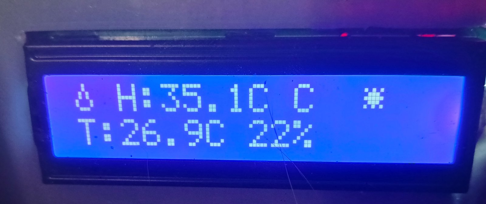
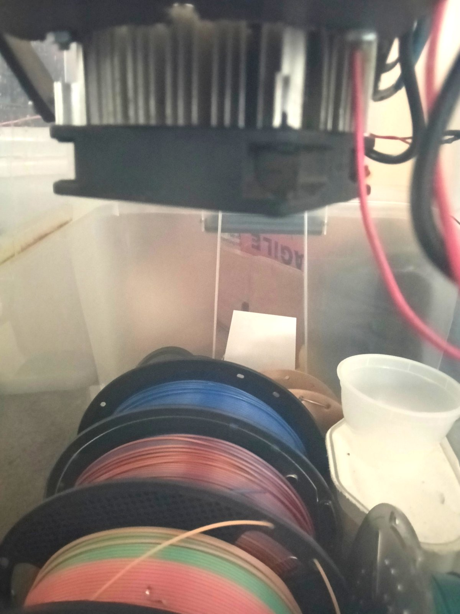
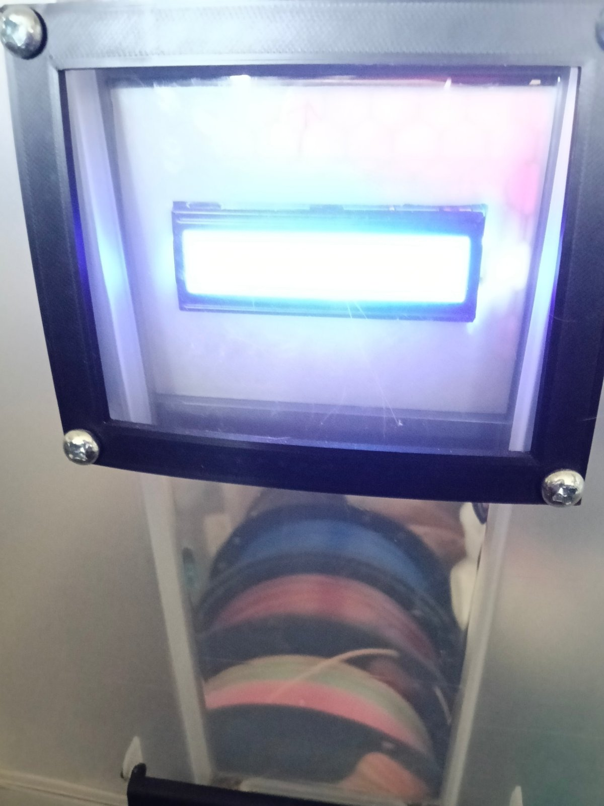
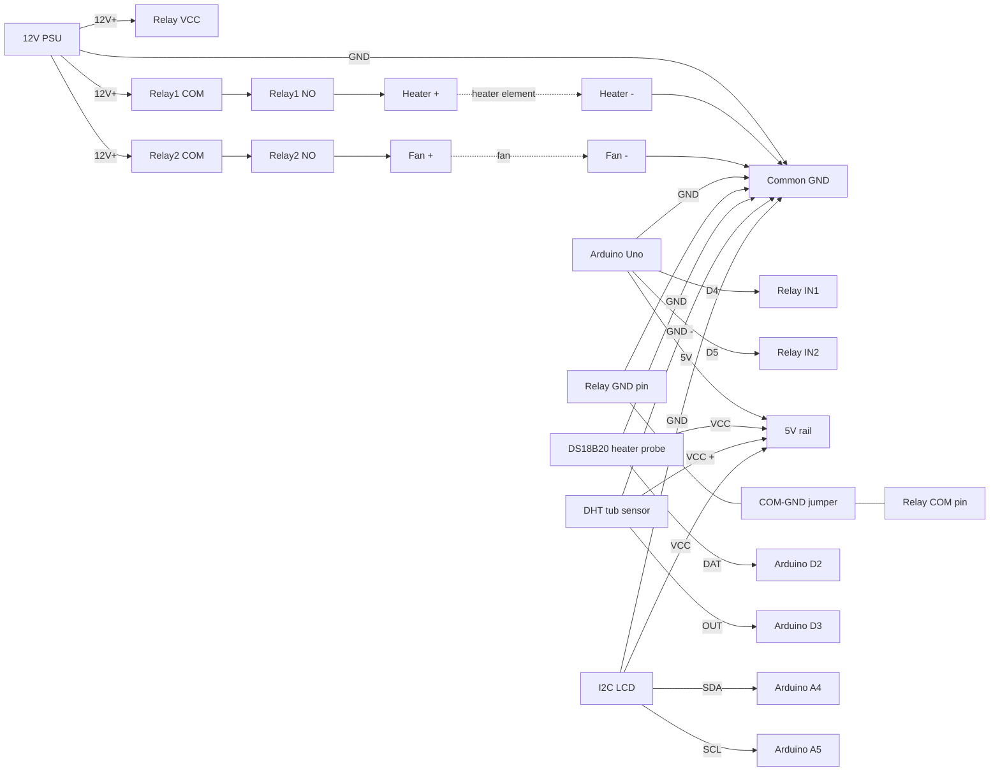

# Filament Dryer Box

An Arduino-controlled 3-tier filament drying box. Heats a tub to a target
temperature range with a relay-switched 12V cartridge heater, cools the
heatsink with a 12V fan, and displays live status on an I2C LCD.

[](https://ko-fi.com/plmangion)

📖 [View full build guide on Instructables](https://www.instructables.com/Arduino-Filament-Dryer-Box-With-Temperature-Humidi/)



**It works.** Heater probe 35.1 °C and climbing, tub air 26.9 °C at 22 % humidity,
heater (flame) and fan (blades) both on. Six 1 kg spools fit in the tub with room to spare.

## Finished build

| Heater + fan on the catwalk above the spools | LCD window in the printed top tier |
|---|---|
|  |  |

- The electronics sleeve (Arduino, relay board, LCD) bolts **inside** a clear tub, so the LCD
  reads through the wall. The DHT sensor sits in the tub air it is drying.
- The cartridge heater lives in a finned copper/aluminium heatsink hung upside down on a printed
  "catwalk" arm, with a 120 mm fan blowing through the fins so the whole tub warms evenly.
- The DS18B20 probe is clamped in the heatsink next to the cartridge, so the Arduino controls
  the heater on *heatsink* temperature, not air temperature.

## Results so far

- Tub holds 6 x 1 kg spools.
- Tub air settles around 22 % RH with the heater probe at 35 °C (see photo). Room air was
  well above that when the lid went on.
- Drying time per spool and power use: still being measured — will be added here.

## Safety

- The 12 V heater lead **must have an inline fuse** (an automotive blade fuse holder is fine).
- Use a quality branded cartridge heater, not a no-name one.
- Keep the DS18B20 probe firmly clamped to the heatsink so the heater always has temperature
  feedback.
- Use proper crimped or soldered joints on the heater leads.

## Tiers

- **Tier 1** — Arduino Uno + wiring
- **Tier 2** — 4-channel relay board
- **Tier 3 (top)** — I2C LCD display (temps, humidity, heater/fan icons)

## Parts

| Part | Notes | Amazon | eBay |
|---|---|---|---|
| Arduino Uno | main controller | [Amazon](https://www.amazon.com/s?k=Arduino+Uno+R3&tag=plmangion20-20) | [eBay](https://www.ebay.com.au/sch/i.html?_nkw=Arduino+Uno+R3&mkcid=1&mkrid=705-53470-19255-0&siteid=15&campid=5339191706&toolid=10001&mkevt=1) |
| Keyestudio 4-channel relay module (SRD-12VDC-SL-C) | switches heater + fan | [Amazon](https://www.amazon.com/s?k=4+channel+relay+module+5V+Arduino&tag=plmangion20-20) | [eBay](https://www.ebay.com.au/sch/i.html?_nkw=4+channel+relay+module+5V+Arduino&mkcid=1&mkrid=705-53470-19255-0&siteid=15&campid=5339191706&toolid=10001&mkevt=1) |
| DS18B20 waterproof temp probe ("heater" sensor) | mounted on the heatsink | [Amazon](https://www.amazon.com/s?k=DS18B20+waterproof+temperature+probe&tag=plmangion20-20) | [eBay](https://www.ebay.com.au/sch/i.html?_nkw=DS18B20+waterproof+temperature+probe&mkcid=1&mkrid=705-53470-19255-0&siteid=15&campid=5339191706&toolid=10001&mkevt=1) |
| DHT11/DHT22 temp+humidity sensor ("tub" sensor) | mounted inside the drying tub | [Amazon](https://www.amazon.com/s?k=DHT11+DHT22+temperature+humidity+sensor+module&tag=plmangion20-20) | [eBay](https://www.ebay.com.au/sch/i.html?_nkw=DHT11+DHT22+temperature+humidity+sensor&mkcid=1&mkrid=705-53470-19255-0&siteid=15&campid=5339191706&toolid=10001&mkevt=1) |
| 16x2 LCD with I2C backpack (PCF8574T) | status display | [Amazon](https://www.amazon.com/s?k=16x2+LCD+I2C+backpack+PCF8574&tag=plmangion20-20) | [eBay](https://www.ebay.com.au/sch/i.html?_nkw=16x2+LCD+I2C+backpack+PCF8574&mkcid=1&mkrid=705-53470-19255-0&siteid=15&campid=5339191706&toolid=10001&mkevt=1) |
| 12V 70W cartridge heater (6x20mm) | heats the heatsink | [Amazon](https://www.amazon.com/s?k=12V+cartridge+heater+6x20mm&tag=plmangion20-20) | [eBay](https://www.ebay.com.au/sch/i.html?_nkw=12V+cartridge+heater+6x20mm&mkcid=1&mkrid=705-53470-19255-0&siteid=15&campid=5339191706&toolid=10001&mkevt=1) |
| 12V fan (Cooler Master 12025) | cools the heatsink | [Amazon](https://www.amazon.com/s?k=12V+fan+120x25mm+PC+cooling&tag=plmangion20-20) | [eBay](https://www.ebay.com.au/sch/i.html?_nkw=12V+fan+120x25mm&mkcid=1&mkrid=705-53470-19255-0&siteid=15&campid=5339191706&toolid=10001&mkevt=1) |
| External 12V power supply | powers heater, fan, and relay coils | [Amazon](https://www.amazon.com/s?k=12V+5A+power+supply+DC+adapter&tag=plmangion20-20) | [eBay](https://www.ebay.com.au/sch/i.html?_nkw=12V+5A+power+supply+DC+adapter&mkcid=1&mkrid=705-53470-19255-0&siteid=15&campid=5339191706&toolid=10001&mkevt=1) |

### Component photos

| Arduino Uno | Keyestudio 4-ch Relay (SRD-12VDC-SL-C) |
|---|---|
|  |  |

| 16x2 LCD + PCF8574T I2C backpack (front) | I2C backpack (back) |
|---|---|
|  |  |

| DHT11 tub sensor |
|---|
|  |

## Wiring diagram



## Pinout table

| Signal | Arduino pin |
|---|---|
| DS18B20 heater probe DAT | D2 |
| DHT tub sensor OUT | D3 |
| Relay IN1 (heater) | D4 |
| Relay IN2 (fan) | D5 |
| LCD SDA | A4 |
| LCD SCL | A5 |
| Shared 5V | 5V |
| Shared GND | GND |

**Relay board notes**

- Relay board `VCC` and both relay `COM` screw terminals tie to the external
  12V supply's positive rail (relay coils are 12V, not 5V).
- Relay board `GND` pin ties to the common ground shared by the Arduino and
  the 12V supply.
- The `COM`–`GND` jumper (or bridging wire) on the relay board's logic
  header must stay in place — it references the optoisolated inputs to the
  same ground the Arduino uses to drive IN1–IN4 directly.
- Heater wired to Relay1's NO screw, fan wired to Relay2's NO screw.
- IN3/IN4 unused.

## Control logic

- Heater: OFF at 55°C, back ON at 45°C (10°C hysteresis) — driven off the **heater probe** (heatsink temperature)
- Fan: ON when tub humidity > 20%, OFF when tub humidity ≤ 19% — driven off the **DHT tub sensor**

## LCD layout

```
[flame] H:40.0C     [fan]
T:22.0C 45%
```

- Flame icon: filled when heater relay is ON, hollow when OFF
- Fan icon: blade pattern when fan relay is ON, dot when OFF
- Row 2: tub temperature and humidity from the DHT sensor

## 3D-printed parts

The electronics sleeve, heater catwalk and struts are in [`3d-parts/`](./3d-parts/)
as OpenSCAD source and STL, with print notes.

Also on Thingiverse: https://www.thingiverse.com/thing:7434905

## Firmware

See [`filament_dryer.ino`](./filament_dryer.ino).

Requires libraries: `OneWire`, `DallasTemperature`, `DHT sensor library`
(Adafruit) + `Adafruit Unified Sensor`, `LiquidCrystal_I2C`.

## Build log

- Aug 2026 — Full wiring (Arduino, relay board, heater probe, tub DHT sensor, I2C LCD)
  complete and tested on the bench
- Aug 2026 — Wiring glued in place, tiers joined, printed sleeve mounted inside the tub
- Oct 2026 — Cartridge heater upgraded to a quality branded 12 V unit
- Nov 2026 — Running. Heater, fan and LCD all working, spools in the tub (photos above)

## License

MIT — see [LICENSE](LICENSE). Build one, improve it, share it back.
